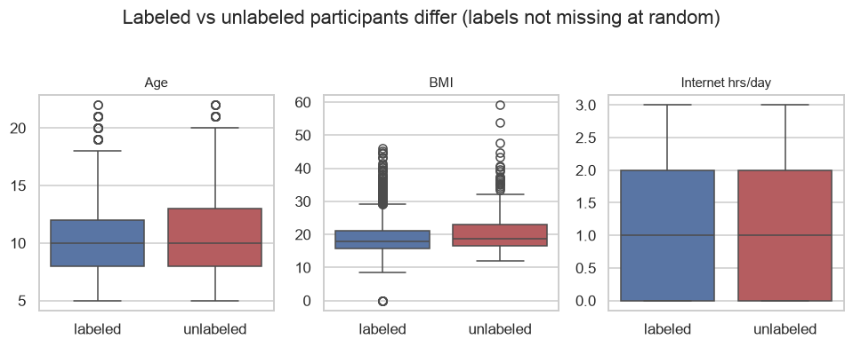
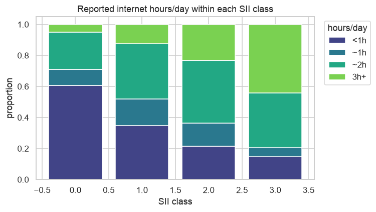
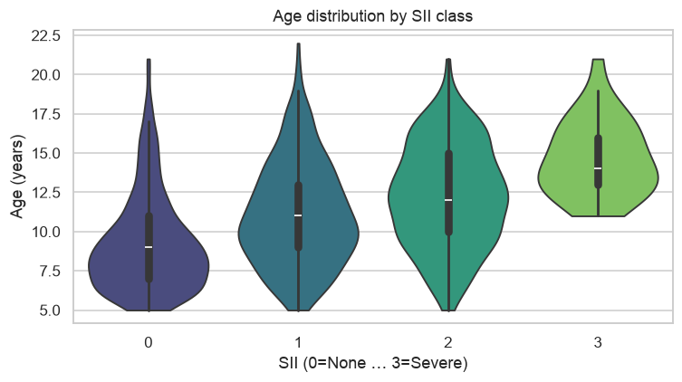
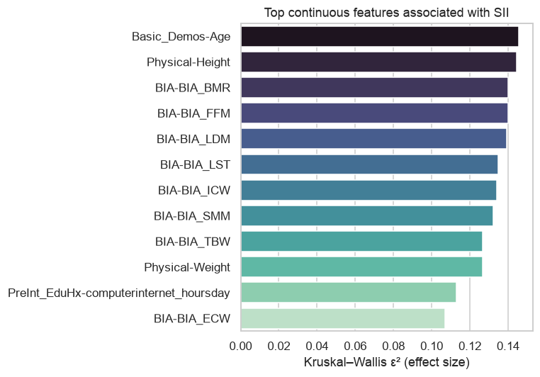
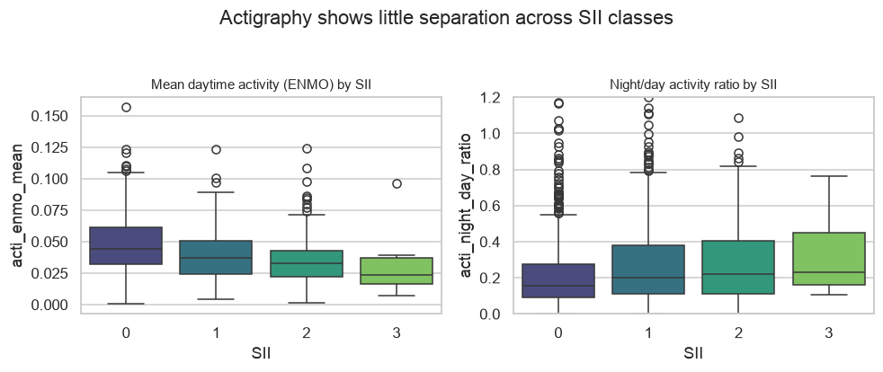

# Predicting Problematic Internet Use in Youth from Physical, Fitness, and Actigraphy Data: A Gradient-Boosting Study with Rigorous Cross-Validation

**Abstract**

Problematic internet use (PIU) in children and adolescents is typically assessed with lengthy
parent-report questionnaires. We study whether the *Severity Impairment Index* (SII), a four-level
ordinal measure derived from the Parent–Child Internet Addiction Test (PCIAT), can instead be predicted
from routinely collected physical, fitness, demographic, and questionnaire measures, together with
wrist-worn accelerometer (actigraphy) recordings, using the Healthy Brain Network dataset released for
the Child Mind Institute Kaggle competition. Framing SII prediction as ordinal regression with
Quadratic-Weighted-Kappa (QWK)-optimized decision thresholds, we build a gradient-boosting pipeline and
evaluate every design decision under matched 5-fold × 3-seed out-of-fold (OOF) cross-validation. Our final
model — a weight-optimized blend of CatBoost, LightGBM, and XGBoost with CatBoost trained under per-fold
pseudo-labeling of unlabeled participants — attains QWK = 0.4623. We report two carefully controlled
negative results: (i) wrist actigraphy carries little predictive signal for SII in this cohort
(actigraphy-only QWK ≈ 0.19) and does not improve a tabular model, and (ii) the most severe class
(1.2% of labels) is effectively unlearnable, with class-weighting providing no benefit under QWK. We
emphasize methodological hazards specific to this dataset — target leakage through PCIAT items, a large
not-missing-at-random unlabeled subset, and a 20-row public leaderboard — and show how OOF discipline
guards against them.

**Keywords:** problematic internet use, ordinal regression, quadratic weighted kappa, gradient boosting,
pseudo-labeling, actigraphy, class imbalance.

---

## 1. Introduction

Excessive and compulsive internet use is an increasing concern in pediatric mental health. The standard
screening instrument, the Parent–Child Internet Addiction Test (PCIAT) [Young 1998], requires a parent to
answer 20 items; the summed score is bucketed into a four-level Severity Impairment Index (SII):
none (0), mild (1), moderate (2), severe (3). Because completing the PCIAT is burdensome and depends on an
engaged caregiver, a natural question is whether SII can be predicted from measures that are already
collected during a clinical or research visit — demographics, physical and fitness assessments,
bio-electric impedance, sleep questionnaires — and from objective wearable-sensor data.

This paper reports an end-to-end study on the Healthy Brain Network cohort [Alexander et al. 2017] as
distributed by the Child Mind Institute "Problematic Internet Use" competition. Our contributions are:

1. A reproducible four-phase pipeline (analysis → cleaning → feature engineering → modeling) with all
   design choices validated by matched out-of-fold cross-validation rather than the public leaderboard.
2. A careful treatment of three dataset-specific hazards: **target leakage** (the PCIAT items that define
   the label are present only in training), **label missingness** (31% of training rows are unlabeled and
   the missingness is not at random), and an uninformative **20-row public test**.
3. Two controlled negative results — actigraphy adds no predictive value, and the severe class is
   unlearnable — each established with a matched baseline, not asserted.
4. A final model reaching QWK = 0.4623 via pseudo-labeling and OOF-optimized model blending.

## 2. Related work

**Internet-addiction assessment.** The PCIAT adapts Young's Internet Addiction Test [Young 1998] to a
parent-report format. SII is a monotone bucketing of the PCIAT total, so predicting SII is an ordinal
classification problem.

**Ordinal targets and QWK.** The competition metric is Cohen's quadratic weighted kappa [Cohen 1968],
which penalizes predictions by the squared distance from the true ordinal class. A common and effective
strategy is to fit a real-valued regressor and then optimize class-boundary thresholds directly for QWK,
which we adopt.

**Gradient-boosted decision trees.** XGBoost [Chen & Guestrin 2016], LightGBM [Ke et al. 2017], and
CatBoost [Prokhorenkova et al. 2018] are the standard tools for heterogeneous tabular data with missing
values; all three handle NaN natively, which suits this dataset's heavy, structured missingness.

**Semi-supervised learning.** Pseudo-labeling [Lee 2013] augments training with model-predicted labels for
unlabeled data. We use a leakage-safe, per-fold variant with soft (continuous) targets and down-weighting.

**Clinical instruments used as features.** The FitnessGram battery, the Children's Global Assessment Scale
(CGAS) [Shaffer et al. 1983], the Sleep Disturbance Scale for Children, and bio-electric impedance analysis
(BIA) are all represented in the feature set.

## 3. Data and exploratory analysis

The dataset contains 3,960 training participants (82 columns) and a 20-row visible test set (59 columns);
the scored test set is much larger and hidden. Fields span 11 instruments documented in a data dictionary
(81 fields): Demographics, Internet Use, the Children's Global Assessment Scale (CGAS), Physical Measures,
FitnessGram (Vitals/Treadmill/Child), bio-electric impedance analysis (BIA), Physical Activity
Questionnaires for children and adolescents (PAQ-C/PAQ-A), the Sleep Disturbance Scale for Children (SDS),
and the PCIAT. Per-participant wrist-accelerometer time series (`enmo`, `anglez`, non-wear flag, light,
timestamps) are provided at a 5-second cadence for a subset of participants. We devoted a full analysis
phase to understanding this structure before any modeling, because — as the figures below show — the
dataset's difficulty is driven less by the choice of learner than by its target definition, its
missingness, and the weakness of its objective signals.

### 3.1 Target: derivation, imbalance, and boundary sensitivity

SII is derived deterministically from the PCIAT total score by three cut-points (0–30→0, 31–49→1,
50–79→2, 80+→3); we verified **100%** agreement between the recomputed and provided labels. This is a
double-edged fact: it confirms the mapping, but it also means the 20 `PCIAT-*` item columns *are* the
target and must never be used as features (Section 3.4). The class distribution is severely imbalanced,
and 416 labeled participants sit within ±2 PCIAT points of a cut-point — near-boundary cases that dominate
the achievable QWK.

### 3.2 Missingness and a biased label set

Only **69.1%** of training rows carry a label (1,224 missing SII). Feature missingness is heavy and
organized by whole instrument — a participant either completed an instrument or skipped it entirely
(PAQ-Adolescent 88%, Fitness-Endurance ~81%, BIA ~50%). We therefore treat *instrument completion* itself
as a feature (per-instrument "was-completed" flags and a per-row missing count).

Crucially, the missing labels are **not missing at random**. Participants without an SII label differ
systematically from labeled ones — they are older, have higher BMI, and report more internet use
(Mann–Whitney p ≪ 0.001). Simply discarding unlabeled rows for supervised training therefore introduces a
selection bias, which motivates the semi-supervised approach in Section 4.

### 3.3 Data quality

Exploratory screening surfaced sentinel and physiologically impossible values that would distort any
model: CGAS scores of 999 (valid range 1–100), negative BIA body-fat percentages (minimum −8745), extreme
BIA masses, and seven implausible BMI rows. These are mapped to missing under documented per-column rules
(Section 4).

### 3.4 What actually predicts SII

The strongest single predictor is the coarsest one: reported computer/internet hours per day (Cramér's
V = 0.21). Its relationship with SII is clean and monotone — the share of participants reporting 3+ hours
rises from roughly 5% in the None class to nearly half in the Severe class.

Among continuous features, age and body-size measures dominate (Kruskal–Wallis ε² ≈ 0.15). Much of this is
an age effect: SII rises with age, and most BIA and fitness measures are themselves age-driven — which is
why we add age-normalized features in Section 4 rather than letting the model rediscover age repeatedly.

That mutual correlation is visible directly: the BIA and body-size features form a tightly collinear block,
so their individual importances should be read as one shared signal rather than many independent ones.

In short, the exploitable signal is concentrated in a few tabular features — reported internet use, sleep
disturbance, physical activity, CGAS, and age-normalized body size — and it is diffuse. This framing sets
realistic expectations for the modeling that follows.

## 4. Methodology

**Cleaning.** Sentinel and physiologically impossible values are set to missing under documented per-column
rules (CGAS ∉ [1,100]; BMI ∉ [8,60]; body-fat ∉ [0,75]; BIA masses/rates ≤ 0; out-of-range vitals, height,
weight). No value imputation is performed: the gradient-boosting learners consume NaN directly, and
missingness is retained as signal via indicator features.

**Feature engineering.** From the 58 usable raw columns we derive 77 tabular features (19 engineered):
per-instrument "was-completed" flags, a per-row missing count, a merged physical-activity score across the
child/adolescent forms, an aggregate FitnessGram-zone score, BIA composition ratios, age-normalized
physical measures, and an internet-hours × age exposure term. Categorical/season fields are integer-encoded
in a shared category space.

**Actigraphy features.** Each participant's series is summarized into 31 features: enmo activity statistics
and percentiles, wear time and non-wear fraction, days recorded, anglez posture statistics, ambient light,
six-hour circadian activity bins, and night/day and weekend/weekday activity ratios.

**Modeling.** We frame SII as real-valued regression and convert predictions to classes with three
thresholds optimized directly for QWK by Nelder–Mead on OOF predictions. Base learners are LightGBM,
XGBoost, and CatBoost with mild regularization. All evaluation uses StratifiedKFold (K=5) repeated over
three seeds {42, 2024, 7}; reported QWK is the OOF score, and thresholds are fit on OOF predictions to
avoid optimistic bias. Test predictions are bagged across fold models.

**Pseudo-labeling.** To exploit the 1,224 unlabeled rows without leakage, we regenerate pseudo-labels
*inside every fold*: a LightGBM generator trained on the fold's real labels predicts soft (continuous)
targets for unlabeled rows, which are appended to that fold's training set with weight 0.3. Validation
folds always contain only real labels.

**Blending.** After selecting each base learner's better pseudo/no-pseudo variant, blend weights over the
three models are optimized on OOF QWK (equivalent to linear stacking with a QWK objective).

## 5. Experiments

We evaluate, each against a matched baseline under identical folds and seeds:
(a) tabular-only vs. tabular+actigraphy features;
(b) a two-model actigraphy stack, where an actigraphy-only model's OOF prediction becomes a single
meta-feature for the tabular model;
(c) class-weighting (square-root inverse-frequency) and pseudo-labeling, separately and combined;
(d) equal-weight vs. OOF-weight-optimized blending.

## 6. Results

**Feature configuration (Table 1).** Adding the 31 actigraphy aggregates did not help; the ensemble OOF
QWK fell from 0.458 to 0.452, and no actigraphy feature entered the LightGBM importance top-15.

*Table 1. OOF QWK by feature configuration.*

| configuration | LightGBM | XGBoost | CatBoost | Ensemble |
|---|---|---|---|---|
| tabular-only | 0.447 | 0.448 | **0.459** | 0.458 |
| tabular + actigraphy | 0.449 | 0.450 | 0.454 | 0.452 |

**Actigraphy stack.** An actigraphy-*only* model reaches just QWK ≈ **0.19** on the 996 covered
participants, and folding its OOF prediction into the tabular model as a single meta-feature still
underperforms the baseline (0.453 vs. 0.459). Only 36% of labeled rows have actigraphy. The reason is
visible directly in the features: mean daytime activity and the night/day activity ratio shift only
slightly across SII classes, with heavily overlapping distributions (Figure 9). We conclude that, in this
cohort, wrist-movement summaries contain little information about SII.

**Class imbalance and pseudo-labeling (Table 2).** Class weighting did not improve QWK and never recovered
any recall on class 3 (0.00 across all settings; 34 training examples). Per-fold pseudo-labeling improved
CatBoost from 0.4591 to 0.4612; it slightly degraded LightGBM/XGBoost, so an equal-weight ensemble did not
benefit.

*Table 2. Class-3 / pseudo-labeling experiments (tabular-only).*

| config | CatBoost | Ensemble | recall(2) | recall(3) |
|---|---|---|---|---|
| baseline | 0.4591 | 0.4582 | 0.45 | 0.00 |
| class-weight | 0.4514 | 0.4528 | 0.46 | 0.00 |
| **pseudo** | **0.4612** | 0.4574 | 0.40 | 0.00 |
| class-weight + pseudo | 0.4543 | 0.4536 | 0.46 | 0.00 |

**Blending (Table 3).** Assigning each model its best pseudo variant (CatBoost→pseudo, others→plain) and
optimizing blend weights on OOF yields weights CatBoost 0.59 / LightGBM 0.21 / XGBoost 0.20 and QWK
**0.4623**, our best result.

*Table 3. Final blending.*

| candidate | OOF QWK |
|---|---|
| CatBoost + pseudo (single) | 0.4612 |
| equal-weight blend (best variants) | 0.4597 |
| **OOF-optimized blend** | **0.4623** |

**Overall progression.** 0.459 (tabular CatBoost) → 0.4612 (+ pseudo-labeling) → **0.4623** (weighted blend).

## 7. Discussion

The predictive signal for SII is concentrated in a handful of tabular features — sleep disturbance, the
merged physical-activity score, CGAS, cardiovascular vitals, body size (age-normalized), and reported
internet hours — consistent with the univariate analysis. That reported internet hours is the single
strongest categorical predictor is intuitive but limited: it is itself a coarse self/parent report, and the
remaining signal is diffuse.

The actigraphy null result is the study's most notable finding. A priori, objective movement and
circadian-disruption features seemed the most promising route beyond self-report. In practice, actigraphy
alone predicts SII barely above chance for this metric (QWK ≈ 0.19), and its low coverage (36%) means the
features act mainly as noise for the majority of participants. Simple aggregate statistics may be too
coarse; a learned sequence representation could in principle recover more, but the low ceiling implied by
the actigraphy-only model tempers expectations.

Pseudo-labeling helped, but selectively — only CatBoost benefited, which is why per-model variant selection
before blending mattered. The gains are small (≈ 0.001–0.002 QWK per step) and we are explicit that the
final blend's weight optimization on OOF carries a mild overfitting risk; we retain it because the effect is
directionally consistent across seeds and because the equal-weight blend of best variants also improved on
the original all-equal ensemble.

## 8. Limitations

- **Ceiling of the label.** SII is a coarse bucketing of a self/parent-report instrument; the achievable
  QWK from indirect measures appears modest.
- **Severe class.** With 34 examples, class 3 is effectively unlearnable; because QWK is distance-weighted
  and this class is 1.2% of labels, the optimizer rationally never predicts it. This bounds recall but
  costs little QWK.
- **Not-missing-at-random labels.** Dropping unlabeled rows for supervised training is not perfectly
  unbiased; pseudo-labeling mitigates but does not eliminate this.
- **Small public test.** With 20 visible rows, all model selection relies on OOF QWK; we report no public
  or private leaderboard scores.
- **Feature-set ceiling.** Remaining ideas (nested threshold optimization, CatBoost hyperparameter search,
  richer interactions) are each estimated to be worth < 0.005 QWK.

## 9. Conclusion

Routinely collected physical, fitness, and questionnaire data predict the Severity Impairment Index with
QWK ≈ 0.46 under rigorous cross-validation, with reported internet hours, sleep disturbance, activity, and
age-normalized body-size the dominant signals. Wrist actigraphy, despite its appeal, contributes almost
nothing in this cohort. Careful handling of target leakage, non-random label missingness, and an
uninformative public leaderboard — combined with leakage-safe pseudo-labeling and OOF-optimized blending —
was more consequential than model choice. The pipeline and all experiments are reproducible from the
accompanying code.

## References

- Alexander, L. M., et al. (2017). An open resource for transdiagnostic research in pediatric mental health
  and learning disorders (the Healthy Brain Network). *Scientific Data*, 4, 170181.
- Chen, T., & Guestrin, C. (2016). XGBoost: A scalable tree boosting system. *KDD*.
- Cohen, J. (1968). Weighted kappa: Nominal scale agreement with provision for scaled disagreement or
  partial credit. *Psychological Bulletin*, 70(4), 213–220.
- Ke, G., et al. (2017). LightGBM: A highly efficient gradient boosting decision tree. *NeurIPS*.
- Lee, D.-H. (2013). Pseudo-Label: The simple and efficient semi-supervised learning method for deep neural
  networks. *ICML Workshop on Challenges in Representation Learning*.
- Prokhorenkova, L., et al. (2018). CatBoost: Unbiased boosting with categorical features. *NeurIPS*.
- Shaffer, D., et al. (1983). A Children's Global Assessment Scale (CGAS). *Archives of General Psychiatry*,
  40(11), 1228–1231.
- Young, K. S. (1998). *Caught in the Net: How to Recognize the Signs of Internet Addiction.* Wiley.

*Reproducibility: see the accompanying `src/` pipeline and `reports/` outputs. All QWK values are
5-fold × 3-seed out-of-fold; seeds {42, 2024, 7}.*
