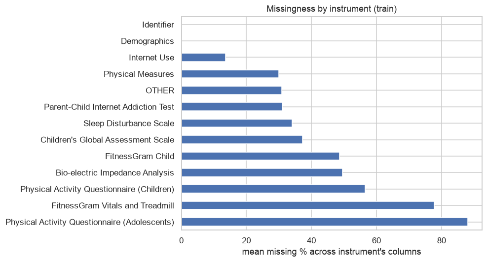
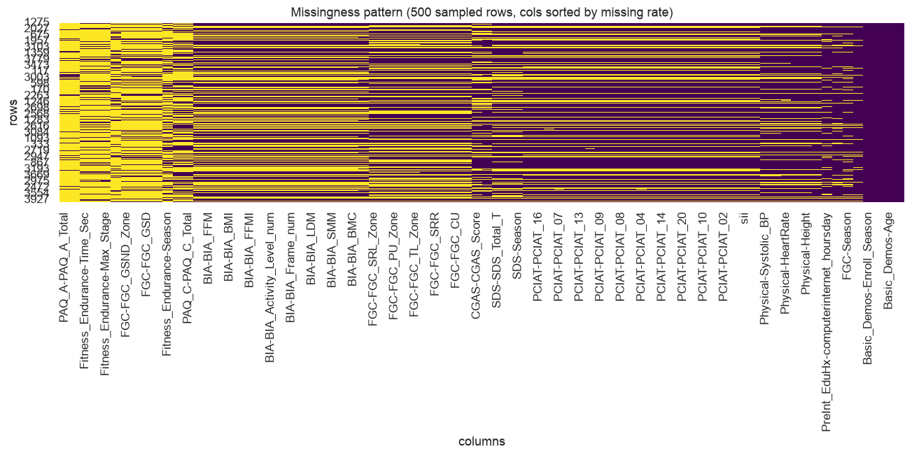
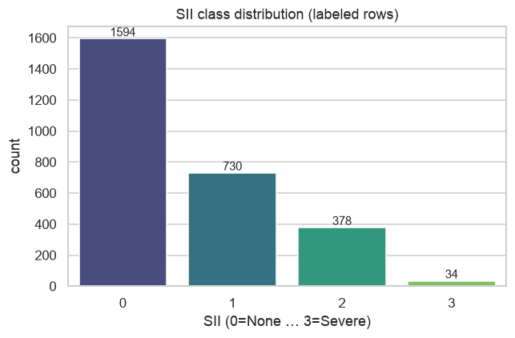
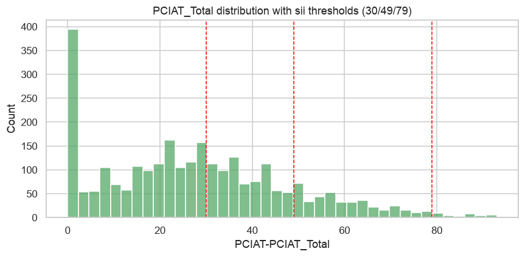
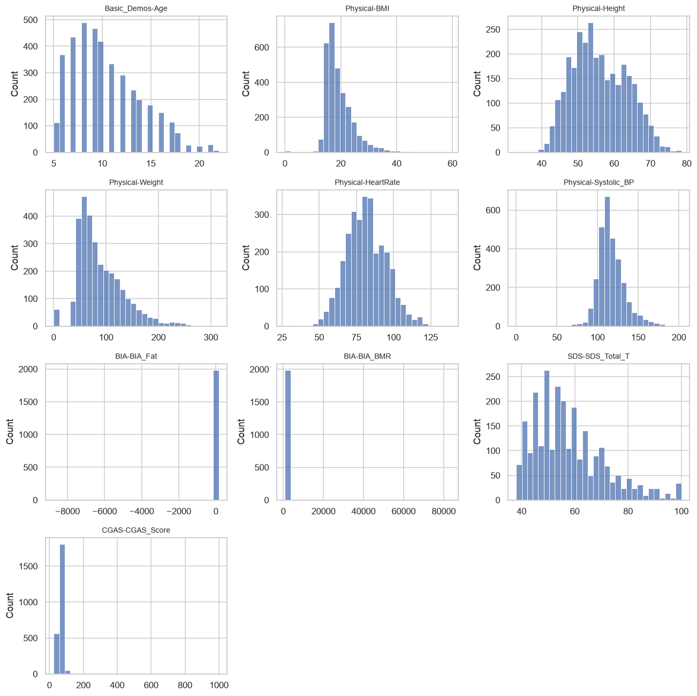
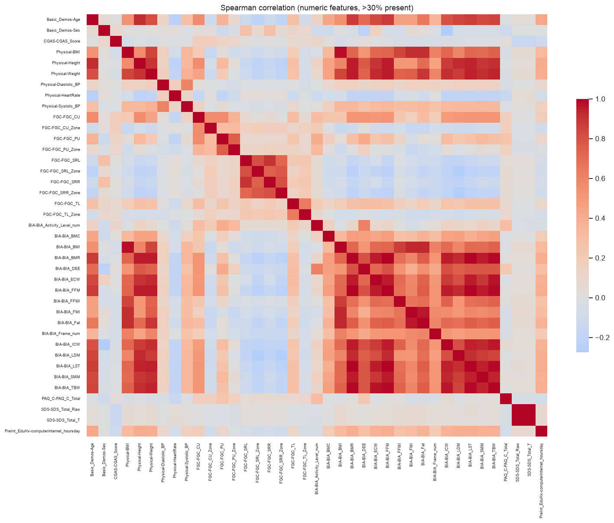
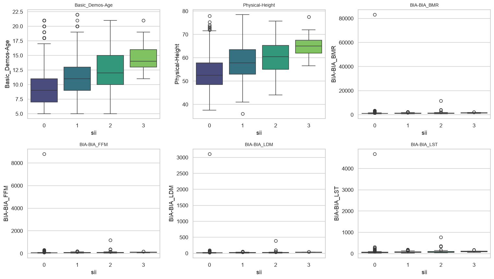

# Phase 1 — Data Analysis & Exploration

CMI: Problematic Internet Use. Auto-generated by `src/eda.py`.

## 1a. Data overview

- train: 3960 rows x 82 cols
- test:  20 rows x 59 cols
- sample_submission columns: ['id', 'sii']

**Columns per instrument (train):**
- Parent-Child Internet Addiction Test: 22
- Bio-electric Impedance Analysis: 17
- FitnessGram Child: 15
- Physical Measures: 8
- FitnessGram Vitals and Treadmill: 4
- Demographics: 3
- Sleep Disturbance Scale: 3
- Children's Global Assessment Scale: 2
- Physical Activity Questionnaire (Adolescents): 2
- Physical Activity Questionnaire (Children): 2
- Internet Use: 2
- Identifier: 1
- OTHER: 1

**Leakage audit — columns in train but NOT test (23):**
`PCIAT-PCIAT_01, PCIAT-PCIAT_02, PCIAT-PCIAT_03, PCIAT-PCIAT_04, PCIAT-PCIAT_05, PCIAT-PCIAT_06, PCIAT-PCIAT_07, PCIAT-PCIAT_08, PCIAT-PCIAT_09, PCIAT-PCIAT_10, PCIAT-PCIAT_11, PCIAT-PCIAT_12, PCIAT-PCIAT_13, PCIAT-PCIAT_14, PCIAT-PCIAT_15, PCIAT-PCIAT_16, PCIAT-PCIAT_17, PCIAT-PCIAT_18, PCIAT-PCIAT_19, PCIAT-PCIAT_20, PCIAT-PCIAT_Total, PCIAT-Season, sii`

**Columns in test but not train:** none

> All PCIAT-* fields and `sii` are train-only. PCIAT defines the target -> must be excluded from features.

## 1b. Missingness analysis

**Top 25 columns by missing rate (train):**

PAQ_A-PAQ_A_Total               88.0
PAQ_A-Season                    88.0
Fitness_Endurance-Time_Sec      81.3
Fitness_Endurance-Time_Mins     81.3
Fitness_Endurance-Max_Stage     81.2
Physical-Waist_Circumference    77.3
FGC-FGC_GSND_Zone               73.2
FGC-FGC_GSD_Zone                73.2
FGC-FGC_GSD                     72.9
FGC-FGC_GSND                    72.9
Fitness_Endurance-Season        67.0
PAQ_C-Season                    56.5
PAQ_C-PAQ_C_Total               56.5
BIA-BIA_DEE                     49.7
BIA-BIA_FFM                     49.7
BIA-BIA_BMR                     49.7
BIA-BIA_BMI                     49.7
BIA-BIA_ECW                     49.7
BIA-BIA_FFMI                    49.7
BIA-BIA_FMI                     49.7
BIA-BIA_Activity_Level_num      49.7
BIA-BIA_Fat                     49.7
BIA-BIA_Frame_num               49.7
BIA-BIA_ICW                     49.7
BIA-BIA_LDM                     49.7

**Actigraphy:** series_*.parquet not downloaded — deferred to Phase 3. Tabular-only for Phase 1.

## 1c. Target analysis (sii)

- rows with sii present: 2736 / 3960 (69.1%)
- rows with MISSING sii: 1224

**sii class distribution:**

sii
0.0    1594
1.0     730
2.0     378
3.0      34
NaN    1224

**sii proportions (labeled only):**

sii
0.0    58.3
1.0    26.7
2.0    13.8
3.0     1.2

**sii vs derived-from-PCIAT_Total agreement:** 100.00% (mapping 0-30->0, 31-49->1, 50-79->2, 80+->3)
- borderline rows within +/-2 of a threshold: 416

**Missing-sii vs labeled population (Mann-Whitney):**

                               feature  mean_labeled  mean_missing       p
                       Basic_Demos-Age         10.24         10.87 2.3e-05
                          Physical-BMI         19.13         20.38 7.2e-06
                       SDS-SDS_Total_T         57.65         61.38 1.4e-01
PreInt_EduHx-computerinternet_hoursday          1.02          1.25 2.2e-06

## 1d. Univariate distributions & outliers

**Most skewed numeric features (|skew| top 12):**

            col   skew      min       max
    BIA-BIA_BMC  43.96    -7.79   4115.36
    BIA-BIA_LDM  42.84     4.64   3108.17
    BIA-BIA_Fat -42.74 -8745.08    153.82
    BIA-BIA_ECW  42.41     1.79   3233.00
    BIA-BIA_BMR  42.18   813.40  83152.20
    BIA-BIA_FFM  42.18    28.90   8799.08
    BIA-BIA_TBW  41.69    20.59   5690.91
    BIA-BIA_DEE  40.76  1073.45 124728.00
    BIA-BIA_ICW  40.41    14.49   2457.91
    BIA-BIA_SMM  39.08     4.66   3607.69
    BIA-BIA_LST  38.68    23.62   4683.71
CGAS-CGAS_Score  30.12    25.00    999.00

**Physiologically implausible value counts (cleaning list for Phase 2):**
- Physical-BMI<=0 or >60: 7
- BIA-BIA_BMI<=0 or >60: 0
- HeartRate<=0: 0

## 1e. Cross-variable relationships

**Continuous features vs sii (Kruskal-Wallis, epsilon^2 effect):** top 15

                               feature  kruskal_eps2       p
                       Basic_Demos-Age         0.146 1.4e-86
                       Physical-Height         0.145 1.6e-79
                           BIA-BIA_BMR         0.140 3.0e-55
                           BIA-BIA_FFM         0.140 3.0e-55
                           BIA-BIA_LDM         0.139 6.0e-55
                           BIA-BIA_LST         0.135 2.8e-53
                           BIA-BIA_ICW         0.134 5.4e-53
                           BIA-BIA_SMM         0.132 2.8e-52
                           BIA-BIA_TBW         0.127 4.5e-50
                       Physical-Weight         0.127 7.2e-71
PreInt_EduHx-computerinternet_hoursday         0.113 2.9e-65
                           BIA-BIA_ECW         0.107 2.3e-42
                           BIA-BIA_DEE         0.099 2.0e-39
                           BIA-BIA_Fat         0.082 1.0e-32
                            FGC-FGC_CU         0.080 1.3e-33

**Categorical/ordinal features vs sii (Cramer's V):** top 15

                               feature  cramers_v       p
PreInt_EduHx-computerinternet_hoursday      0.209 1.5e-69
                     BIA-BIA_Frame_num      0.130 2.4e-11
                      FGC-FGC_SRL_Zone      0.113 2.4e-05
                       Basic_Demos-Sex      0.100 4.4e-06
                      FGC-FGC_GSD_Zone      0.085 5.2e-02
                     FGC-FGC_GSND_Zone      0.082 7.1e-02
                      FGC-FGC_SRR_Zone      0.072 2.2e-02
                       FGC-FGC_PU_Zone      0.069 3.2e-02
            BIA-BIA_Activity_Level_num      0.052 2.5e-01
                       FGC-FGC_CU_Zone      0.048 2.3e-01
                       FGC-FGC_TL_Zone      0.040 4.0e-01

## 1f. Actigraphy exploration

- no series_train.parquet folders found

## 1g. Hypothesis log

Working hypotheses to validate in modeling (with the stats above as first evidence):
1. Higher self/parent-reported internet hours (`PreInt_EduHx-computerinternet_hoursday`) -> higher sii.
2. Poorer sleep (higher `SDS-SDS_Total_T`) associates with higher sii.
3. Lower physical activity (PAQ totals) and lower fitness associate with higher sii.
4. Age is a confounder: many BIA/fitness measures are age-dependent -> engineer age-normalized features.
5. Informative missingness: whether an instrument was completed may itself carry signal.
6. Actigraphy sedentariness (low enmo mean, high non-wear) may add signal for the covered subset.

## Key takeaways -> next phases

- Target is imbalanced and ~31% of train rows are unlabeled (missing sii).
- Drop all PCIAT-* columns from features (leakage); optionally reuse for pseudo-labeling.
- Heavy, instrument-level missingness -> prefer tree models with native NaN + missing-indicator flags.
- Actigraphy present for only part of the cohort -> features must degrade gracefully.
- Use Spearman-clustered redundancy (e.g. BIA block) for selection in Phase 3.
- Optimize QWK via regression + tuned rounding thresholds in Phase 4; validate with StratifiedKFold.
